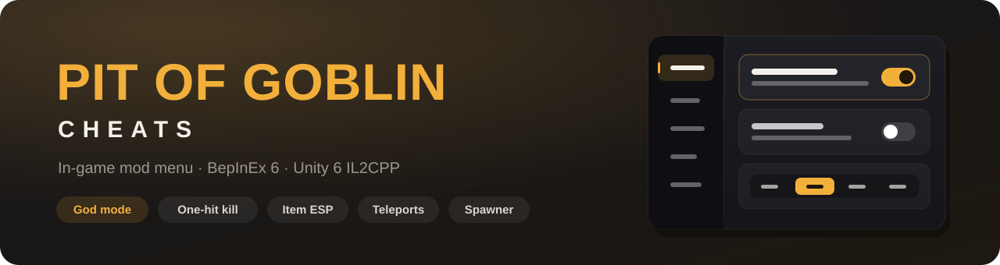

<p align="center">
  
</p>

<p align="center">
  
  
  
  
  
</p>

<p align="center">
  An in-game mod menu for <b>PIT OF GOBLIN</b>: gold, god mode, one-hit kill, revive, player teleports, item and player ESP,<br>
  infinite stamina and magic, faster movement, a minimap, night vision, a bucket compass, round timer control and an item spawner.
</p>

<p align="center">
  <a href="#features">Features</a> ·
  <a href="#installation">Installation</a> ·
  <a href="#usage">Usage</a> ·
  <a href="#settings">Settings</a> ·
  <a href="#troubleshooting">Troubleshooting</a> ·
  <a href="#building-from-source">Building</a>
</p>

---

## Features

### Player

| | Feature | What it does |
|---|---|---|
| 🪙 | **Gold** | Add or take away any amount (type it in or pick 100 / 1,000 / 10,000 / 100,000) |
| ❤️ | **God mode** | Enemies, traps and falls can't hurt you |
| ⚡ | **Infinite stamina** | Run and jump without getting tired |
| ✨ | **Infinite magic** | Charged magic stays after you cast, plus a "Refill" button |
| 👟 | **Movement speed** | x1 / x1.5 / x2 / x3 (the steps are configurable) |

### Combat

| | Feature | What it does |
|---|---|---|
| ⚔️ | **One-hit kill** | Every hit you land on an enemy kills it. Other players are not affected |
| 💀 | **Kill** | Kill any player or enemy straight from the menu, or every enemy around with one click |
| 💚 | **Revive** | Bring yourself or any dead player back with full health, or revive everyone at once |
| 🫂 | **Go to / Bring** | Teleport yourself to any player, pull a player to you, or bring everyone at once |
| 👁️ | **Watch alert** | When a teammate dies, shows whether they are spectating you |

### Visuals

| | Feature | What it does |
|---|---|---|
| 💎 | **Item ESP** | Outlines every item lying around, through walls, in its rarity color |
| 🧍 | **Player ESP** | Outlines your teammates through walls and shows their name and distance (red when dead) |
| 🗺️ | **Minimap** | Small in the corner or large in the middle: you, the bucket, enemies, treasure and food |
| 🌙 | **Night vision** | Brightens the dark, boosts your goblin's light, removes fog |
| 🧭 | **Compass → bucket** | An arrow at the top of the screen always points at the bucket, with distance and height difference |

### World

| | Feature | What it does |
|---|---|---|
| 🌀 | **Teleport to the bucket** | One click (or F10) and you're in the bucket |
| ⏳ | **Round timer control** | Add or take away a minute, or freeze the clock so the bucket waits (host only) |
| ⏱️ | **Return timer** | Time left until the bucket leaves, with a warning near the end |

### Items

| | Feature | What it does |
|---|---|---|
| 📦 | **Item spawner** | Every item in the game with its icon and English name: search, categories, sort by value, x1 / x5 / x10 |

On top of that you get a clickable menu on **Insert**, a small active-cheat list for recordings and optional F1–F10 hotkeys.

### Solo and co-op

- Works solo, as the host and as a guest in someone else's game. The host doesn't need the mod.
- As a guest, gold, items, kills, revives and teleports go through the server using the same functions the game itself uses.
- The round timer can only be changed by the host, because the host decides when the bucket leaves.
- **No free achievements.** Once any cheat is used, Xbox achievements are blocked until the game restarts.
- Only play with people who know you're using the mod. Killing or trolling strangers in matchmaking isn't cool.

## Installation

> **Requirements:** PIT OF GOBLIN on PC (tested on the Xbox / PC Game Pass version 1.0.5) and
> **BepInEx 6 Bleeding Edge for IL2CPP**. BepInEx 5 and the stable 6.0.0-pre **will not work**, because the game runs on Unity 6.

1. **Find the game folder.**
   - Xbox app: PIT OF GOBLIN → `⋯` → *Manage* → *Files* → *Browse*. This opens `...\PIT OF GOBLIN\Content`.
   - Steam: *Properties* → *Installed Files* → *Browse*.

2. **Install BepInEx.** From [builds.bepinex.dev](https://builds.bepinex.dev/projects/bepinex_be) download
   *BepInEx Unity (IL2CPP) for Windows (x64) games* (build **#793** or newer) and extract **everything** into the game folder,
   next to `Pit of Goblin.exe`.

3. **Start the game once** and wait for the main menu. The first start takes 1–3 minutes longer while BepInEx prepares its files.
   Close the game.

4. **Download the mod** from [Releases](../../releases) and extract the zip into the game folder.
   `PitOfGoblinCheats.dll` has to end up in `BepInEx\plugins\`.

5. **Play.** You'll see `Insert - mod menu` in the top left corner.

## Usage

**Insert** opens and closes the menu. Everything is clickable, and you can move the window by dragging its header.
While the menu is open your goblin stands still and the camera doesn't turn.

The menu has five tabs:

- **Player:** gold, god mode, stamina, magic, speed
- **Combat:** one-hit kill, watch alert, a player list with Kill / Bring / Go to / Revive and an enemy list with Kill
- **Visuals:** item ESP, player ESP, minimap, night vision, compass
- **World:** teleport to the bucket, round timer control, return timer, cheat list
- **Items:** the spawner with search and categories

The watch alert sits at the top of the screen, under the compass and timer, and only shows up when a teammate is dead.
The game doesn't send over who a dead player is spectating, so the mod follows the same rules the game uses: a dead player
starts on the first goblin still alive and moves on when that one dies. When you're the last one alive it's certain
(`Bob · spectating you`), otherwise it says `probably`, because they can switch players by hand.

<details>
<summary><b>Hotkeys</b> (optional)</summary>

| Key | Action |
|---|---|
| `F1` | +1,000 gold |
| `F2` | God mode |
| `F3` | Infinite stamina |
| `F4` | Next speed step |
| `F5` | Infinite magic |
| `F6` | Minimap: off → small → large |
| `F7` | Night vision |
| `F8` | Compass |
| `F9` | Show / hide the cheat list |
| `F10` | Teleport to the bucket |
| – | One-hit kill, watch alert, item ESP and player ESP have no key by default, set one in the settings |

You can change or turn off the keys in the settings.
</details>

## Settings

`BepInEx\config\pl.gobliny.pitofgoblincheats.cfg` is created the first time you start the game with the mod.
Edit it with Notepad **while the game is closed**.

| Section | Setting | Default | Description |
|---|---|---|---|
| `Menu` | `Key` | `Insert` | Key that opens the menu |
| `Hotkeys` | `Enabled` | `true` | F1–F10 hotkeys |
| `Hotkeys` | `OneHitKill` / `WatchAlert` / `ItemEsp` / `PlayerEsp` | `None` | Optional keys for these |
| `Gold` | `HotkeyAmount` | `1000` | How much gold F1 gives |
| `Speed` | `Multipliers` | `1, 1.5, 2, 3` | Available speed steps |
| `Magic` | `RefillOnEnable` | `true` | Refills magic when the cheat is turned on |
| `Minimap` | `SmallSize` / `SmallZoom` | `300` / `3` | Look of the small minimap |
| `NightVision` | `Exposure` | `2.5` | Brightening in EV (more = brighter) |
| `NightVision` | `GreenTint` / `DisableFog` | `true` / `true` | Look of the night vision |
| `Timer` | `EnabledOnStart` | `true` | Timer visible right away |
| `Timer` | `StepSeconds` | `60` | How much time the − / + buttons take or add |
| `WatchAlert` | `EnabledOnStart` | `false` | Watch alert on right away |
| `ESP` | `ItemRange` | `60` | Items further away than this (m) are not outlined |
| `Items` | `SpawnDistance` | `1.5` | How far in front of you items appear |
| `Overlay` | `Scale` | `1` | Scale of the whole mod UI |
| `Safety` | `BlockAchievements` | `true` | Blocks achievements after cheats are used |

## Troubleshooting

<details>
<summary><b>Nothing happens after starting the game, there's no text in the corner</b></summary>

Check that `winhttp.dll` and the `BepInEx` folder are next to `Pit of Goblin.exe` and that `PitOfGoblinCheats.dll` is in `BepInEx\plugins`.
The log is in `BepInEx\LogOutput.log`. The line `Pit of Goblin Cheats 1.1.0 ready` means the mod loaded.
</details>

<details>
<summary><b>The minimap says "The map shows up once you are in the dungeon"</b></summary>

The game only makes the dungeon image after the dungeon is generated. If there's still no image during a round,
the mod asks for one itself, and retakes it if it comes out empty. Lines starting with `Map:` in `LogOutput.log` show what's going on.
</details>

<details>
<summary><b>Kill, revive or bring doesn't work on another player</b></summary>

All three are sent to the player who owns the character, so they need a working connection. If that player also runs this mod
with god mode on, kills won't land.
</details>

<details>
<summary><b>The timer buttons say "Only the host can change the timer"</b></summary>

The host's game decides when the bucket leaves, so only the host can add time or freeze it. Guests still see the countdown.
</details>

<details>
<summary><b>The mod stopped working after a game update</b></summary>

An update or the *Repair* option in the Xbox app can remove the BepInEx files. Just install it again.
If the log shows `Patch ... failed`, the game changed in that spot and that one feature needs a mod update.
Report it in [Issues](../../issues) and attach `LogOutput.log`.
</details>

<details>
<summary><b>How to turn off or uninstall the mod</b></summary>

- **For a while:** set `enabled = false` in `doorstop_config.ini`.
- **For good:** delete `winhttp.dll`, `doorstop_config.ini`, `.doorstop_version`, `changelog.txt` and the `BepInEx` and `dotnet` folders from the game folder.
</details>

## Building from source

You need the [.NET SDK 8](https://dotnet.microsoft.com/download) and the game with BepInEx installed and started at least once
(the build uses the files in `BepInEx\interop`).

```powershell
git clone https://github.com/stxxchu/pitofgoblin-modmenu.git
cd pitofgoblin-modmenu
dotnet build src/PitOfGoblinCheats -c Release -p:GameDir="D:\Xbox Games\PIT OF GOBLIN\Content" -p:CopyToGame=true
```

- `GameDir` points to the game folder. To avoid passing it every time, create `PitOfGoblinCheats.csproj.user`
  next to the project (it's in `.gitignore`):
  ```xml
  <Project>
    <PropertyGroup>
      <GameDir>D:\Xbox Games\PIT OF GOBLIN\Content</GameDir>
    </PropertyGroup>
  </Project>
  ```
- `CopyToGame=true` copies the DLL straight into `BepInEx\plugins`.
- `scripts\pack.ps1` builds a release and packs it into `dist\PitOfGoblinCheats-vX.Y.Z.zip`.

<details>
<summary><b>How it works under the hood</b></summary>

- The game runs on Unity 6 with IL2CPP (metadata v39). The mod is a BepInEx 6 plugin with HarmonyX patches on the game classes generated by Il2CppInterop.
- **God mode** blocks `Entity.TakeDamage`, `EntityPlayer.TakeDamageOwner` and `Entity.Kill` for your character.
  `EntityHealth.TakeDamage` is skipped on purpose: it returns a `(float, bool)` struct, and patching it through Il2CppInterop
  corrupts the return value so the game treats every hit as lethal.
- **One-hit kill** is a prefix on `Entity.TakeDamage` that raises the damage when the hit comes from you
  (your character or an item you own as `damageOwner`). The game sends that damage to the target's owner as an RPC, so it works as a guest too.
- **Kill** calls `Entity.Kill` when you own the target (the host owns enemies) and otherwise sends lethal damage through `Entity.TakeDamage`.
- **Revive** uses `EntityPlayer.Revive`, which the game forwards to the player's owner. If the character is gone entirely,
  the mod asks the bucket to respawn the player with `Bucket.RequestRespawnRpc`, the same call the game makes when the bucket travels.
- **Go to / Bring** use the game's own player teleport: `EntityPlayer.Teleport` for you and `EntityPlayer.TeleportRpc`
  for others, which runs on the machine that owns that player.
- **Watch alert:** spectating is local only in the game (`SpectatorController`), so the mod repeats its logic. A dead player
  starts on the first living goblin in `SpawnedObjectsService.m_players` and moves to the next one when that goblin dies.
- **ESP** adds a second Easy Performant Outline `Outlinable` to items and teammates, with both the visible and the hidden
  (behind walls) passes on. Renderers come from the game's own `AddToOutline`, so it outlines the same parts the game highlights.
  The game's hover highlight is left alone.
- **Round timer:** `ElapsedGameTime` is `ServerTime − m_startTime`, and the host ends the round once it passes `RoundTime`.
  Moving `m_startTime` on the host adds or removes time, and pinning it freezes the clock.
- **Speed** multiplies `PlayerController` speeds only for the duration of its `Update` and restores them right after, so the game's buffs keep working.
- **Magic** skips `MagicClass.UseCharge` for your character.
- **Menu cursor:** the game locks the cursor every frame, so the mod hooks the native `Cursor.lockState` / `Cursor.visible`
  and keeps the cursor free while the menu is open. Movement is disabled through the game's own `GameStateService.RegisterDisableInput`.
- **Minimap** takes the top-down dungeon view from `GenerateMap`, the same one the paper map in the game uses, and turns it
  into a readable image with automatic contrast.
- **Night vision** adds a global HDRP `Volume` (exposure, tint, fog) and boosts the `GoblinEyes` light,
  only for your character and separately for every light.
- **Return timer** shows `GameMode_Round.RoundTime - ElapsedGameTime`, same as the "Clock" upgrade.
- **Spawner** takes items from the network prefab list (`NetworkConfig.Prefabs`) and creates them with
  `NetworkSpawnManager.InstantiateAndSpawn`, just like the game does. As a guest it asks the server for the item with
  `PersistentPlayer.SpawnObjectRpc`, a function the game already has. Names come from the game's English localization
  (`InventoryItem.GetLocalizedNameTerm` + I2 `LocalizationManager.GetTranslation`) and icons are cut out of the sprite atlas.
- **Achievements** are blocked in `XboxRuntimeManager`.
</details>

## License

[MIT](LICENSE). This is an unofficial fan mod and isn't affiliated with Friendly Foe or the game's publisher.
PIT OF GOBLIN and related names belong to their owners. Use at your own risk.
